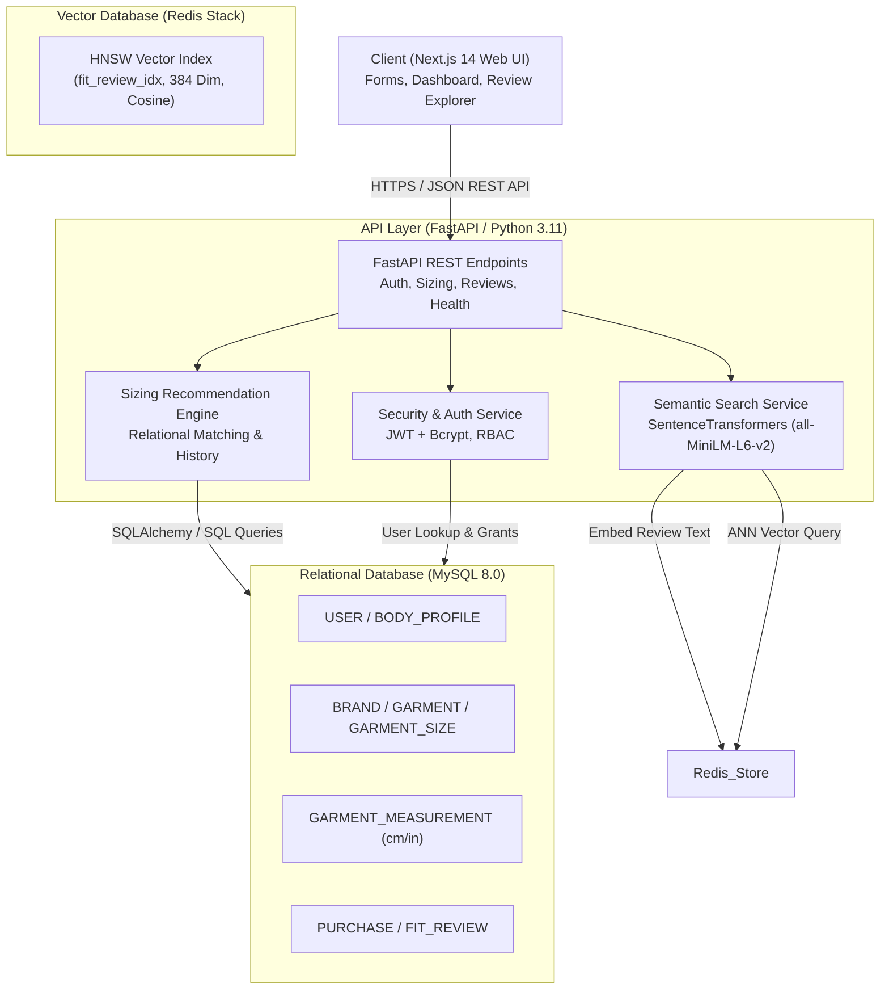

# FitCheck — System Architecture

FitCheck is a cross-brand women's apparel fit intelligence system. It combines structured garment measurements and purchase history in MySQL with semantic vector search in Redis Stack.

---

## 1. High-Level Architecture

---

## 2. Component Breakdown

### Frontend (Next.js + TypeScript)
- **Framework:** Next.js App Router with TypeScript.
- **Styling:** Custom CSS design system with responsive layouts, modern glassmorphism accents, and accessible contrast.
- **Key Views:**
  1. *Size Recommendation Dashboard:* Compare current known brand sizes against target brand specs.
  2. *Body Profile Manager:* Input and update personal waist, hip, thigh, and inseam measurements.
  3. *Semantic Fit Explorer:* Natural language search over real fit complaints and reviews (e.g., "loose around waist", "stiff denim").
  4. *Admin Garment & Sizing Portal:* Manage catalog entities and verify measurement inputs.

### Backend (Python FastAPI)
- **Framework:** FastAPI with asynchronous I/O and Pydantic validation.
- **ORM / Querying:** SQLAlchemy with PyMySQL driver for connection pooling, transactions, and typed models.
- **Embedding Generation:** HuggingFace `sentence-transformers/all-MiniLM-L6-v2` generating 384-dimensional dense embeddings locally without external API dependencies.

### Relational Store (MySQL 8.0)
- **Scope:** Source of truth for all users, profiles, brands, garments, sizes, measurements, purchases, and reviews.
- **Integrity:** Enforces foreign key relationships (`CASCADE` on dependent measurements; `RESTRICT` on purchased garments) and check constraints.

### Vector Store (Redis Stack)
- **Scope:** In-memory vector database utilizing the RedisSearch engine (`redis-stack-server`).
- **Index Type:** Hierarchical Navigable Small World (`HNSW`) index with `COSINE` distance metric.
- **Metadata Tagging:** Review vectors are tagged with `brand_id`, `garment_size_id`, and `overall_fit` for filtered hybrid queries.

---

## 3. Core Workflows

### A. Cross-Brand Size Equivalence Workflow
1. User provides a source brand and size where they have a confirmed `KEPT` purchase with `GOOD` fit satisfaction (or uses their stored `BODY_PROFILE`).
2. Backend queries MySQL for physical garment measurements of the source garment size in centimeters.
3. Backend executes a multi-table JOIN across target brand garments and sizes within the same category (e.g., "Jeans"), calculating absolute dimensional delta:
   $$\Delta_{\text{fit}} = w_1 \cdot |W_{\text{target}} - W_{\text{source}}| + w_2 \cdot |H_{\text{target}} - H_{\text{source}}| + w_3 \cdot |T_{\text{target}} - T_{\text{source}}|$$
4. The size with minimal deviation within acceptable tolerance ($\pm 2.0\text{ cm}$) is recommended with an explainable match score.

### B. Semantic Fit Experience Search Workflow
1. User searches: *"Does this waistband gap when sitting?"*
2. Backend generates a 384-dimensional vector embedding for the query string.
3. Backend runs a KNN vector search query against Redis Stack index `fit_review_idx`, filtering by the target garment ID.
4. Top matching reviews are returned with cosine similarity scores, highlighting recurring physical fit observations.

---

## 4. Dual-Level Role-Based Access Control (RBAC)

FitCheck implements security at **two distinct levels**:

1. **Application Layer (FastAPI JWT Tokens):**
   - User signs in; backend issues a signed JWT containing claims (`user_id`, `email`, `role`).
   - FastApi dependency injection (`require_role("ADMIN")`) guards administrative catalog and measurement endpoints.
2. **Database Layer (MySQL Accounts & Grants):**
   - Application runs under a restricted database account (`fitcheck_app_user`) granted only `SELECT, INSERT, UPDATE, DELETE` on operational tables.
   - Administrative DDL operations (`ALTER, DROP, CREATE`) are restricted to the DBA account (`fitcheck_admin`), satisfying Rubric Item 12.
